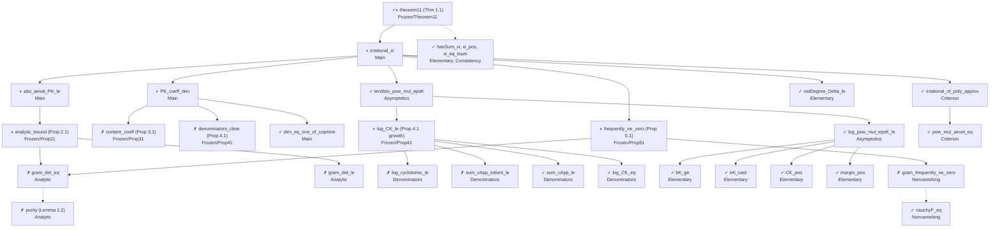

# Blueprint: irrationality of ζ_{1/p}(3)

Dependency graph of the formalisation (one node per Lean declaration, status as of the last
build; `✓` proved, `◐` proved from nodes that contain `sorry`, `✗` statement only).
The graph is the one a `leanblueprint` would draw; the `\lean` / `\uses` data below is kept in the
docstrings of the declarations (LeanArchitect style), so that Lean stays the source of truth.

## Nodes

| Node | Manuscript | Statement (informal) | Uses | Status |
|---|---|---|---|---|
| `theorem11` | Thm 1.1 | `Irrational (xi p)` for `2 ≤ p` | `irrational_xi` | ◐ |
| `irrational_xi` | §6 | assembly of the contradiction | `irrational_of_poly_approx`, `PK_coeff_den`, `abs_aeval_PK_le`, `tendsto_pow_mul_epsK`, `frequently_ne_zero`, `natDegree_PK_le` | ◐ |
| `irrational_of_poly_approx` | §6 (criterion) | integer polynomials, decay, infinitely many nonzero values ⇒ irrational | `pow_mul_aeval_eq` | ✓ |
| `PK_coeff_den` | Cor. 4.2 | `P_K ∈ ℤ[X]` | `content_coeff`, `denominators_clear`, `den_eq_one_of_coprime` | ◐ |
| `abs_aeval_PK_le` | §6 | `|P_K(ξ_p)| ≤ ε_K` | `analytic_bound`, `CK_pos` | ◐ |
| `tendsto_pow_mul_epsK` | §6 | `b^K ε_K → 0` | `log_pow_mul_epsK_le`, `log_CK_le`, `margin_pos` | ◐ (✓ given `log_CK_le`) |
| `log_pow_mul_epsK_le` | §6 | `log(b^K ε_K) ≤ −ε K³ log p + C' K² log K` | `bK_ge`, `eK_cast`, `CK_pos` | ✓ |
| `analytic_bound` | Prop 2.1 | `|Δ_K(ξ_p)| ≤ K!(12(2K−1)²)^K p^{−b_K}` | `gram_det_eq`, `gram_det_le` | ◐ |
| `gram_det_eq` | Lemma 1.2 + §3 | real Gram determinant `= Δ_K(ξ_p)` | `purity` | ✗ |
| `gram_det_le` | §2 | triple-root basis bound | — | ✗ |
| `purity` | Lemma 1.2 | `L((1−q^a x)⁻¹) = ξ_p − S_a` | `g`, `S_eq_sum_g` | ✗ |
| `content_coeff` | Prop 3.1 | `p^{−e_K}Δ_K` integral at `ℓ ∣ p` | — (route in `Content.lean`) | ✗ |
| `leading_coeff` | Prop 3.1 | `[X^K]Δ_K = ±p^{e_K}` | — | ✗ |
| `denominators_clear` | Prop 4.1 | `C_K Δ_K ∈ ℤ[1/p][X]` | — (route in `Denominators.lean`) | ✗ |
| `log_CK_le` | Prop 4.1 / App. A | `log C_K ≤ (321/64π²)K³ log p + O(K² log K)` | `log_cyclotomic_le` ✗, `sum_cApp_totient_le` ✗, `sum_cApp_le` ✓, `log_CK_eq` ✓ | ◐ |
| `frequently_ne_zero` | Prop 5.1 | infinitely many `Δ_K(ξ_p) ≠ 0` | `gram_frequently_ne_zero`, `gram_det_eq` | ◐ |
| `gram_frequently_ne_zero` | §5 | Padé argument on `𝓕` | `cauchyF`, `cauchyF_eq` ✓ | ✗ |

## Order of attack for the remaining nodes (suggested)

1. `gram_det_eq` and `purity` (Lemma 1.2 + partial fractions): needs `θ²` of a geometric series,
   `tsum` manipulations and the partial-fraction identity for `x^k/F_K`; the ζ(5) formalisation has
   the analogous `Apery/PartialFractions.lean` and `Apery/HermiteFormula.lean`.
2. `gram_det_le`: the jet bounds (2.2), the `W_K` bounds (2.3), the entry bound (2.5) and
   `Matrix.det_le` with a unipotent change of basis (`Matrix.det_mul`, `det_of_upperTriangular`).
3. `log_cyclotomic_le`, `sum_cApp_totient_le`: Möbius inversion and
   `∑_{d ≤ M} φ(d) ~ 3M²/π²` (not in Mathlib; needs `ArithmeticFunction.sum_eq_iff_sum_mul_moebius_eq`
   and `∑ μ(a)/a² = 6/π²` from `hasSum_zeta_two`).
4. `content_coeff`, `leading_coeff`: ℓ-adic series (Mathlib `Padic`, `PadicInt`) or Gauss
   valuations on `ℚ[X]` as in mo271/Zeta5 `Apery/Arith/Val.lean`.
5. `denominators_clear`: the local cluster-basis analysis at roots of unity; the largest piece
   (the ζ(5) analogue, `Apery/Arith/*`, is several thousand lines).
6. `gram_frequently_ne_zero`: the Padé argument; needs the non-rationality of `𝓕` (poles) and
   the degree count of `V = T_{n+1}Q_n − T_nQ_{n+1}`.
